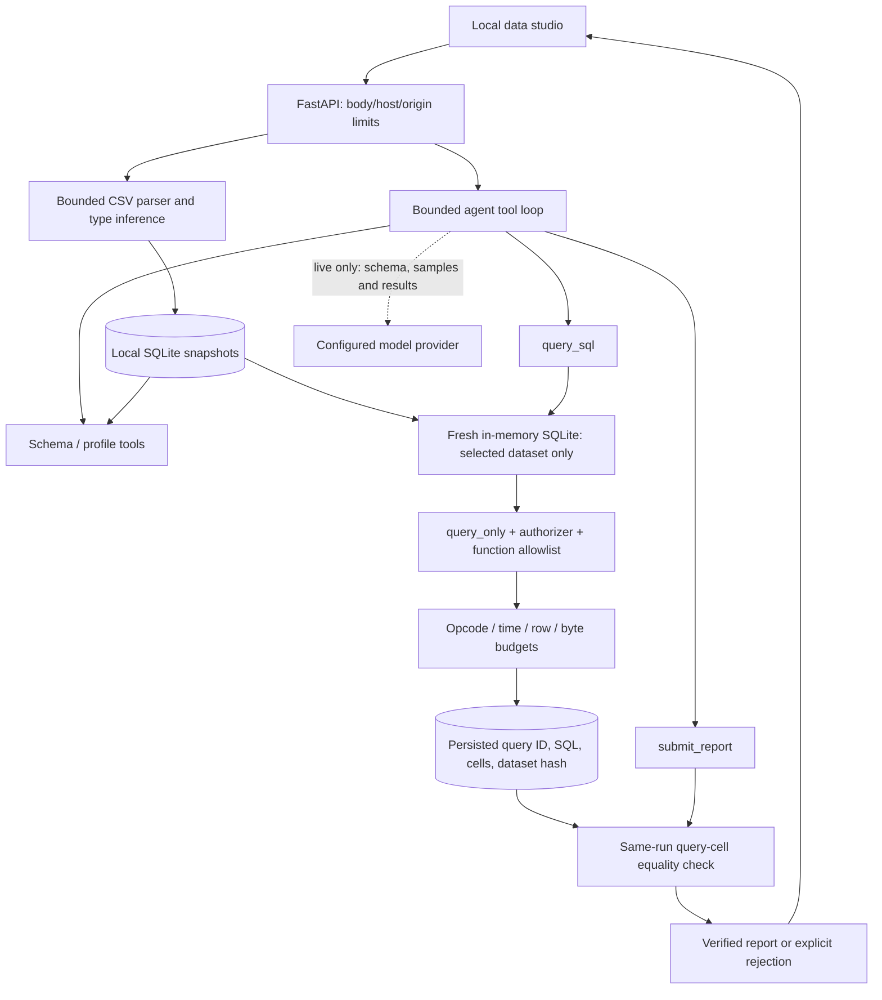

# Architecture and evidence boundary

## Why separate the query database

Metadata (runs, events, dataset snapshots, query evidence) lives in the persistent store. Agent SQL
never executes against that connection. Each query creates a new in-memory connection containing
only the chosen immutable dataset. A generated identifier names its table; labels are not SQL.
The authorizer permits SELECT, reads of this exact table, and a short function allowlist. Everything
else is denied. `COUNT(*)` produces an empty-column read, which is allowed only for the selected
generated table; SQLite metadata tables remain inaccessible.

The textual SELECT prefix is only a coarse first check. It is not the security mechanism.
The SQLite authorizer, `PRAGMA query_only`, separate connection, SQLite limits, progress handler,
and output caps form the actual read boundary. SQL errors return a generic message. Connections
are closed in `finally`. The server never imports dataset content as Python or executes shell code.

## Import and storage

CSV parsing is strict and bounded before insertion. Header identifiers are validated and unique
case-insensitively. All rows have the same width. Nulls, numeric types, and text are inferred across
the complete bounded dataset. Leading-zero identifiers and unsafe large numbers remain text.
UTF-8 cell and row byte limits prevent oversized fields. Dataset and run count reservations use
SQLite transactions. History survives process restart; active runs are marked interrupted on startup.
The application intentionally provides no automatic replay or resume protocol for model rounds.

## Agent and provider

Live mode exposes four function tools: inspect schema, profile dataset, execute SQL, submit report.
Complete assistant/tool groups are added to the in-memory model conversation. The loop is limited
to eight rounds by default and sixteen tool executions. A report is accepted only when submitted
alone. The provider adapter limits payload sizes, streams responses with a total per-attempt
deadline, retries transient errors at most twice, and rejects incomplete, filtered, refused, malformed,
or oversized responses. It never publishes upstream error bodies or keys.

User questions and dataset values are untrusted inputs. Prompt instructions request that they be
treated as data, but security does not depend on the model obeying: the available capabilities stay
read-only and bounded even when the model is induced to issue hostile SQL. Live model inputs leave
the machine for the configured provider; local data storage does not imply local inference.

## What report verification means

Each claim must resolve to an existing query of the same run and dataset, then match its exact cell.
Foreign query IDs, missing rows/columns, string-versus-number substitutions, and forged values fail.
Charts also refer to stored result columns and accept finite nonnegative values. Results disclose
truncation. Free prose is instructed to be qualitative; numeric characters in prose/labels are rejected.

This is **provenance verification, not SQL semantic validation**. A syntactically allowed SELECT
could contain the wrong business filter or a constant such as `UNION SELECT 999`. Matching that
result is not proof of a correct answer. Units, causal narratives, and natural-language meaning still
need human review. The digit guard is a narrow product constraint, not a truth detector.

## Evaluation

Seven deterministic fixture questions execute real SQL against known data; expected first claims
are revenue 8000, orders 80, profit 4560, leading region revenue 4700, leading category revenue 4600,
first-month revenue 3500, and gross margin 57 percent. An eighth fixture checks unsupported-question
abstention. Tests additionally probe malformed CSV, protected SQL boundaries, cross-run provenance,
resource limits, interrupted runs, provider protocol/errors, and API controls.

These fixtures are regression tests, not an independent benchmark, training data, or evidence of
live-model quality. A future live evaluation should version questions, independently reviewed SQL
and expected answers, provider/model configuration, and execution cost separately.
